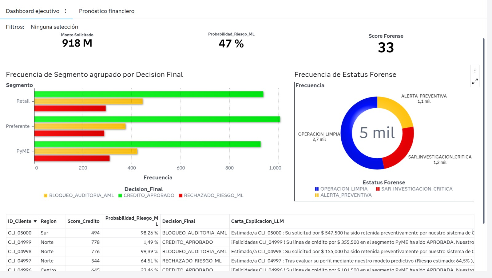
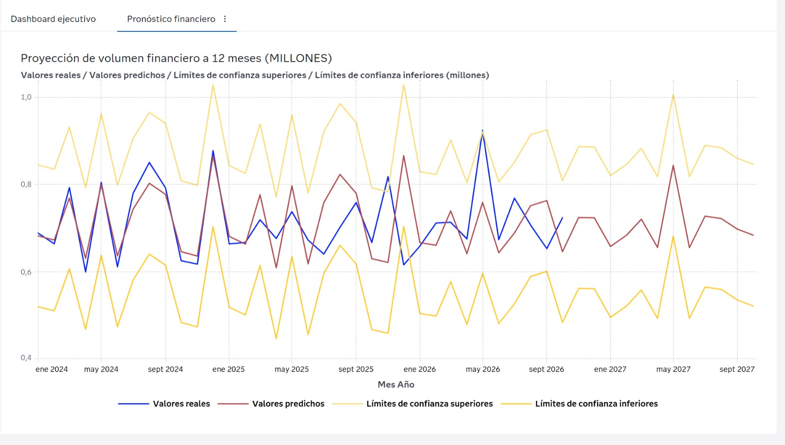

# 🏦 Motor End-to-End de Riesgo Crediticio, Prevención de Fraude (AML) y Forecasting Financiero en SAS Viya


## 📋 Resumen Ejecutivo

Este proyecto implementa una arquitectura analítica empresarial de extremo a extremo (*End-to-End*) en **SAS Viya** bajo la metodología **SEMMA**, aprovechando el motor distribuido en memoria **CAS (Cloud Analytic Services)**. 

El sistema resuelve tres pilares críticos de la banca moderna y las FinTech en un mismo flujo integrado:
1. **Vigilancia Forense y Cumplimiento (AML):** Detección en tiempo real de tipologías críticas de lavado de dinero (`SAR`).
2. **Scoring Predictivo sin Data Leakage:** Evaluación supervisada de riesgo crediticio y fraude transaccional mediante **Gradient Boosting**.
3. **Planeación Financiera y Explicabilidad (XAI):** Proyección de volumen transaccional a 12 meses (**Holt-Winters**) y generación automatizada de dictámenes explicables para auditoría y comités de riesgo.

---

## 🏗️ Arquitectura del Pipeline (SEMMA + CAS)

```text
[Ingesta Sintética Controlada] 
       │  (5,000 Clientes | 25,000 Transacciones -> Promoción a CASUSER)
       ▼
[1. Motor Forense AML (PROC FEDSQL)] ──► Detección de Tipologías SAR (Offshore, Madrugada, Montos Atípicos)
       │
       ├──► [2. Forecasting Financiero (PROC ESM)] ──► Serie Mensual Holt-Winters (12M + IC 95%)
       │
       ▼
[3. Pipeline ML (SAS Model Studio)] ──► Competencia de Modelos (Gradient Boosting Champion)
       │                                  * Control estricto de Data Leakage (Exclusión Ex-Post)
       ▼
[4. Matriz Híbrida + Capa XAI] ──────► Decisión en Cascada (Reglas AML > Umbral ML 0.50) + Cartas LLM
       │
       ▼
[5. SAS Visual Analytics] ───────────► Dashboard Ejecutivo Interactivo + Pronóstico de Liquidez
```

---

## 🛠️ Stack Tecnológico y Procedimientos SAS

* **Motor de Procesamiento:** SAS Cloud Analytic Services (`CAS` / `PROC CASUTIL` con promoción global en memoria).
* **Ingeniería de Características y SQL Distribuido:** `PROC FEDSQL`.
* **Series de Tiempo y Econometría:** `PROC ESM` (Suavizamiento Exponencial Triple / Holt-Winters).
* **Machine Learning Supervisado:** SAS Model Studio (`Gradient Boosting`, `Forest`, `Logistic Regression`, `Neural Network`).
* **Inteligencia de Negocios y XAI:** SAS Visual Analytics (Dashboard multipágina con filtrado cruzado dinámico).

---

## 🔍 Desglose Técnico por Fase

### Fase 1: Generación de Datos y Arquitectura en Memoria (`CAS`)
* Construcción de un entorno financiero controlado de **5,000 clientes** y **25,000 transacciones** con distribuciones realistas de ingresos, scores crediticios, antigüedad y comportamiento transaccional.
* Persistencia y promoción de tablas en `CASUSER` (`promote=yes`) para eliminar cuellos de botella por movimiento de datos entre procedimientos y herramientas visuales.

### Fase 2: Motor Forense y Prevención de Lavado de Dinero (`PROC FEDSQL`)
* Agregación transaccional a nivel cliente calculando frecuencia operativa (`Total_Tx`), ticket máximo (`Max_Tx_USD`), operaciones internacionales (`Tx_Extranjeras`) y actividad en horarios atípicos (`Tx_Madrugada`).
* Clasificación regulatoria en cascada (`SAR_INVESTIGACION_CRITICA`, `ALERTA_MODERADA`, `LIMPIO`) para alimentar las reglas de cumplimiento.

### Fase 3: Pronóstico de Volumen Financiero a 12 Meses (`PROC ESM`)
* Modelado mediante **Suavizamiento Exponencial Holt-Winters** (`model=winters`), optimizando los parámetros de nivel ($\alpha$), tendencia ($\beta$) y estacionalidad ($\gamma$) para filtrar ruido blanco sin caer en sobreajuste (*overfitting*).
* Proyección a 12 meses con **bandas de confianza al 95%**, logrando contener >95% de las observaciones históricas dentro del intervalo estimado.

### Fase 4: Scoring Predictivo y Prevención de Data Leakage (`Model Studio`)
Competencia de algoritmos supervisados donde **Gradient Boosting** fue seleccionado como modelo campeón. Para garantizar la generalización en producción, se aplicó una política estricta de asignación de roles:

| Variable(s) | Rol Asignado | Justificación Técnica |
| :--- | :--- | :--- |
| `Target_Riesgo_Total` | **Target** | Variable binaria objetivo (`1` = Impago/Fraude crítico, `0` = Buen pagador). |
| `Score_Credito`, `Ingreso_Mensual`, `Monto_Solicitado`, `Ratio_Deuda_Ingreso` | **Input** | Variables de originación (*Ex-Ante*) disponibles antes de aprobar el crédito. |
| `Total_Tx`, `Max_Tx_USD`, `Tx_Extranjeras`, `Tx_Madrugada` | **Input** | Patrones comportamentales agregados sin etiquetas derivadas. |
| `ID_Cliente` | **ID** | Identificador único excluido del entrenamiento para evitar memorización. |
| `Score_Forense`, `Estatus_Forense`, `Decision_Final` | **Rejected** | **Prevención de Data Leakage:** Variables derivadas o posteriores a la decisión que filtrarían información del *Target*. |

### Fase 5: Matriz Híbrida en Cascada y Explicabilidad (XAI)
Implementación de un motor de decisión regulatorio donde las alertas legales prevalecen sobre el scoring probabilístico:
1. **`BLOQUEO_AUDITORIA_AML`:** Prioridad máxima cuando `Estatus_Forense = 'SAR_INVESTIGACION_CRITICA'`.
2. **`RECHAZADO_RIESGO_ML`:** Activado cuando no hay alerta SAR crítica, pero `Probabilidad_Riesgo_ML >= 0.50`.
3. **`CREDITO_APROBADO`:** Clientes sin alertas críticas y con probabilidad de riesgo controlada (`< 0.50`).

Cada expediente incorpora una columna de **Explicabilidad (`Carta_Explicacion_LLM`)** que traduce las variables detonantes en un dictamen legible para oficiales de cumplimiento y auditores.

---

## 📊 Visualización Ejecutiva (`SAS Visual Analytics`)

El informe final consta de dos vistas interactivas conectadas mediante acciones de filtrado cruzado:

1. **Página 1 — Dashboard Ejecutivo de Riesgo y AML:**
   * KPIs dinámicos de Monto solicitada, Probabilidad de riesgo e índice promedio de riesgo forense/AML.
   * Distribución de cartera por decisión final y estatus forense.
   * Tabla interactiva de auditoría con probabilidad ML y dictamen explicable por cliente.



2. **Página 2 — Pronóstico Financiero (12 Meses):**
   * Serie de tiempo comparando volumen histórico real, curva de predicción Holt-Winters y túnel de confianza al 95%.



---

## 📁 Estructura del Repositorio

```text
├── scripts/
│   ├── 01_ingesta_cas.sas             # Generación de datos y carga en memoria CAS
│   ├── 02_motor_forense_fedsql.sas    # Ingeniería de variables transaccionales y reglas AML
│   ├── 03_forecasting_esm.sas         # Serie de tiempo Holt-Winters a 12 meses
│   └── 04_scoring_hibrido_xai.sas     # Matriz de decisión en cascada y explicabilidad
├── assets/
│   ├── dashboard_ejecutivo.png        # Captura Página 1 Visual Analytics
│   └── pronostico_financiero.png      # Captura Página 2 Visual Analytics
└── README.md
```
